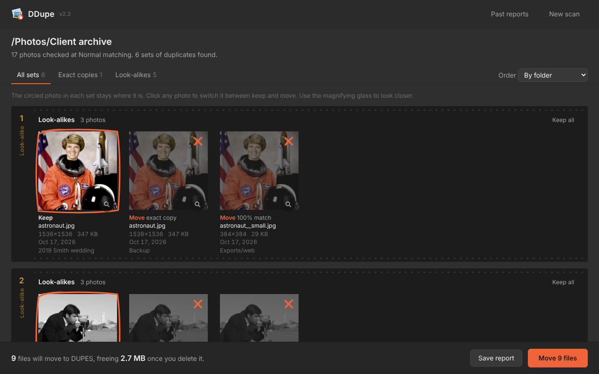
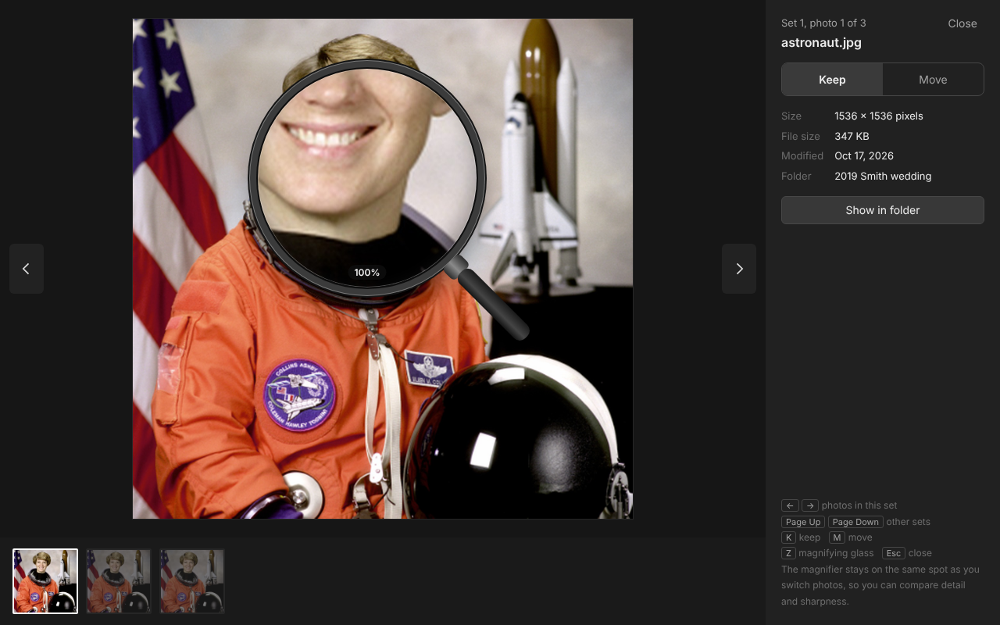

<p align="center"></p>

<h1 align="center">DDupe</h1>
<p align="center"><b>Free duplicate photo finder for Windows</b><br>
Finds exact copies <i>and</i> look-alikes in your JPEG archive. You choose what to keep. Nothing is ever deleted.</p>

<p align="center"></p>

---

## Download

Go to **[Releases](../../releases/latest)** and download **DDupe.exe**. That one file is the whole program: no installer, nothing else to download.

**Requirements:** Windows 10 or 11 (64-bit). DDupe opens in its own window using Microsoft Edge, which is built into Windows. You don't need Edge as your browser.

## Why DDupe exists

I worked for many years as a commercial and industrial photographer, and later as a portrait photographer. Digital photography creates mountains of clutter: backups, exports, re-saves and edits of the same picture. It has to be weeded out regularly, or you drown in it and keep buying more storage. I needed a duplicate finder for decades and never found one that worked well, so I built DDupe with Claude (an AI assistant). Claude wrote the code; I brought what photographers actually need. On its first day it freed almost a terabyte of storage for me.

## What it finds

- **Exact duplicates:** byte-for-byte identical files, even with different names.
- **Look-alikes:** the same picture saved again. That includes resized, re-compressed, brightened, colour-adjusted, black and white, rotated, date-stamped or slightly cropped copies.
- **The best shot in a burst** (new in 2.4). In look-alike sets, DDupe checks faces for **blinks** and **soft focus**, and keeps the frame where eyes are open and faces are sharpest.

## How to use it

1. **Open DDupe.exe** and click **Choose folder** (or paste a path, or pick a recent folder). Every subfolder is included. You can pick a **whole drive**, like `D:\`.
2. **Choose how close a copy needs to be:**
   - **Strict:** only resized, re-saved or rotated copies
   - **Normal** (recommended): also edited, brightened, stamped or slightly cropped copies
   - **Loose:** also heavier crops and near-identical frames from the same moment (check these by eye)
3. **Leave "Check faces in look-alikes" on** (recommended) to catch blinks and soft focus.
4. **Scan.** A film-strip progress bar shows how far along it is. You can stop at any time.
5. **Review the contact sheet.** Each set of duplicates is a strip. The photo that stays is circled in grease pencil, and the others are marked to move.
   - **Click any photo** to switch it between keep and move. Every set always keeps at least one photo.
   - Filter by exact copies or look-alikes, or sort by most space saved.
6. **Look closer** with the magnifying-glass button on any photo (see below).
7. **Move.** Click **Move files** and confirm. The extras go into a **DUPES** folder inside your photo folder, keeping their subfolders.
8. **When you're happy,** delete the DUPES folder yourself to free the space. To clean another folder, click **New scan**.

## Face checks: blinks and focus

When several frames of the same moment are found (a burst, or near-identical portraits), DDupe looks at the faces in each one:

- **Eyes closed:** someone blinked in this frame but not in the others.
- **Soft focus:** the faces are noticeably less sharp than in the best frame.
- **Sharpest faces:** the best frame of the set.

If the frame DDupe would normally keep has a blink or soft faces, it keeps the best frame instead, and the strip says *"Keeper chosen for open eyes and sharp faces"*. You can always click to change it.

- Faces are only compared between frames of the **same set**, which makes the checks reliable. A brightened, black and white or recompressed copy has the same eyes, so it is never called a blink.
- Only photos in look-alike sets are checked, so even whole-drive scans stay quick.
- In the full-size viewer, tick **Show faces found** (or press **F**) to see each face and eye that was found.
- Small faces (under about 90 pixels across) are checked for focus but not for blinks.
- This is **not** face recognition: DDupe doesn't identify or name anyone. Everything happens on your computer, and nothing is sent anywhere.

## Whole drives and fast rescans

- **Pick a whole drive** and DDupe scans every folder on it. It automatically skips Windows' own folders (Windows, Program Files, ProgramData, app data, the Recycle Bin, System Volume Information) and Lightroom's preview cache, so only your photos are scanned.
- **DDupe remembers photos it has already read.** It keeps a small fingerprint file at `%LOCALAPPDATA%\DDupe\fingerprints.bin`. Photos that haven't changed are not read again, so rescanning a drive takes seconds or minutes instead of an hour, and a scan you stop picks up where it left off.
- The fingerprint file holds each photo's location, size, date, fingerprints and face-check results (face positions and small eye-shape samples used to tell blinks from edits). It never leaves your computer, and you can delete it at any time; DDupe simply rebuilds it on the next scan.

## The magnifying glass

<p align="center"></p>

Open any photo full size, then **click on the photo** and a magnifying glass appears. It shows that spot at actual pixels (100%), so you can check focus and detail.

- Move the mouse to look around. Scroll to zoom to 200% or 300%. Click again to put it away.
- **The magnifier stays on the same spot when you switch photos** (arrow keys), so you can compare the same detail across copies and keep the sharpest one.
- Keyboard: **←/→** photos in the set, **Page Up/Down** other sets, **K** keep, **M** move, **Z** magnifier, **Esc** close.
- **Show in folder** opens the photo in File Explorer.

## Spreadsheets and history

- After every move, DDupe quietly saves an **Excel spreadsheet** to **Documents\DDupe Reports**. It never opens by itself.
  - **Summary:** folder, date, matching level, photos checked, files moved, space used
  - **Moved files:** where each file came from, where it is now, the copy that was kept, size, dimensions, date and match %
  - **All duplicates:** every photo in every set, marked kept or moved
  - File paths are clickable, so you can open any photo straight from Excel. Headers stay in place, and every column can be filtered.
- The reports folder is separate from your photos on purpose: **the spreadsheets stay after you delete DUPES**, so you keep a lasting log book of every cleanup.
- Click **Past reports** in the top bar to open that folder. **Save report** creates a spreadsheet and a printable contact sheet *before* you move anything.
- A plain-text list of moves is also kept in `DUPES\moved_files_log.txt`.

## Your photos are safe

- DDupe **never deletes or changes your photos.** It only moves duplicates into DUPES, after you confirm.
- It never connects to the internet. Its window talks only to DDupe itself on your own computer, protected by a secret key, so other programs and websites can't use it.
- If anything interrupts a move, nothing is lost: files already moved are in DUPES, and the rest are where they were. Scan the same folder again and DDupe picks up where it left off, because DUPES is always skipped.

## Windows and antivirus warnings

DDupe is free and isn't signed with a paid certificate, so security software doesn't know it yet.

**"Windows protected your PC":** click **More info → Run anyway** the first time.

**Trend Micro and other antivirus.** A new program that reads and moves many photos looks like ransomware to security software. Trend Micro's **Folder Shield** may pause or close DDupe and ask whether to trust it.

- If that happens during a move, DDupe shows a **"Waiting for DDupe"** screen. Trust DDupe, and the window carries on by itself. If DDupe was closed, open it again and scan the same folder.
- **To stop this permanently, add DDupe to Folder Shield's trusted list** ([Trend Micro's instructions](https://helpcenter.trendlife.com/en-us/article/TMKA-19477)):
  1. Open Trend Micro and go to the **Data** tab.
  2. Click **Configure** next to **Folder Shield**.
  3. Click **Trusted Program List → Add → Browse**, and choose DDupe.exe.
  4. Click **Done**.
- **Keep DDupe.exe in one permanent folder** (for example `Documents\DDupe`) and replace it there when you update. Each new version is a new file, so your antivirus may ask once more after an update.
- **Don't turn your antivirus off.** Trusting DDupe is enough.

## If something goes wrong

DDupe keeps an activity log at:

```
%LOCALAPPDATA%\DDupe\DDupe-log.txt
```

Paste that address into File Explorer's address bar to find it. It records each scan, each move, any file that couldn't be moved and why, and any crash. Please attach it when you report a problem.

## Known limitations

- JPEG only (.jpg, .jpeg, .jpe, .jfif). RAW, PNG, TIFF and HEIC are not checked yet.
- Heavily cropped images, and burst frames where the camera moved noticeably, may not be matched.
- Face checks work best on faces looking toward the camera. Profiles, sunglasses and very small faces may not be found or judged.
- Some unusual JPEGs (from old cameras or scanners) can't be read. They're skipped and counted in the results.

## Comments and suggestions

Welcome! Please open an **[Issue](../../issues)**.

---

## For developers

### Building

Requires [Go](https://go.dev/dl/) 1.23 or newer. No third-party libraries are used.

```
GOOS=windows GOARCH=amd64 go build -buildvcs=false -trimpath -ldflags="-H windowsgui" -o DDupe.exe .
```

`-H windowsgui` makes it a window app (no console). The icon, version details and Windows manifest are pre-compiled in `rsrc_windows_amd64.syso`. To change them, edit `app.rc`, `app.manifest` or `DDupe.ico` and regenerate it, for example with LLVM:

```
llvm-rc -no-preprocess -fo app.res app.rc
llvm-cvtres /machine:x64 /out:rsrc_windows_amd64.syso app.res
```

It also builds and runs on Linux and macOS for development. Set `DDUPE_NO_WINDOW=1` to print the address instead of opening a window.

### How it's put together

| File | What it does |
|---|---|
| `main.go` | Starts a local web server on `127.0.0.1` (random port, secret token) and opens it in an Edge app window. Closes itself a few seconds after the window closes. |
| `engine.go` | Finds photos, fingerprints them in parallel, groups duplicates, moves files. |
| `hash.go` | Look-alike fingerprints (see below) and EXIF rotation. |
| `thumbs.go` | Makes preview thumbnails on demand, with a memory cache. |
| `xlsx.go` | Writes Excel files directly (formatted headers, filters, frozen rows, clickable links). |
| `report.go` | Printable HTML contact sheet; report file names and the reports folder. |
| `faces.go` | Face checks: finds faces and pupils, measures face sharpness and eye opening, and picks the best frame in a set. |
| `cache.go` | The fingerprint memory for fast rescans, and the list of system folders to skip. |
| `pigo/`, `cascades/` | The [pigo](https://github.com/esimov/pigo) face and pupil finder by Endre Simo (MIT licence), with its trained models. One small change: a fixed random seed, so results are the same every run. |
| `logging.go` | Activity and crash log. |
| `native_windows.go` | Windows folder picker, opening files and folders, finding Documents, launching the app window. |
| `ui/index.html` | The whole interface (HTML, CSS and JavaScript, embedded in the .exe). |

### How look-alike matching works

Each photo is shrunk to a 32×32 grayscale thumbnail by averaging every pixel, after applying the camera's EXIF rotation. Two fingerprints are computed from it: a DCT-based perceptual hash and a difference hash. Two photos are look-alikes only when **both** are close enough for the chosen level. Sets are built around the largest photo, and every member must closely match it, so unrelated photos can't be chained together.

### How the face checks work

Faces and pupils are found with pigo on an upright grayscale copy of the photo (at most 1,600 pixels across). For each face:

- **Sharpness** is the variance of the Laplacian on a 192×192 copy of the face, divided by the face's contrast so that brightness changes don't count.
- **Eye opening** is the height of the dark part of each eye (iris and pupil) as a share of the face size. An open eye shows a dark iris many pixels tall, while a closed eye shows only a thin lash line.

Faces are matched across the frames of a set by position. A face found in only a minority of frames is ignored as a false detection. A frame counts as a blink when its eye opening is under 62% of the most open frame **and** its eye shape (a brightness-normalised 24×12 sample, compared allowing a few pixels of shift) clearly differs from that frame, so tonal edits and recompression are never mistaken for blinks. Only full-size frames compete to be the keeper; smaller copies are treated as exports.

### Code signing (future)

The lasting fix for SmartScreen and antivirus warnings is signing each release. [Microsoft's Artifact Signing](https://learn.microsoft.com/en-us/windows/apps/package-and-deploy/code-signing-options) (formerly Trusted Signing) costs about US$10 a month and is open to individual developers in the USA and Canada. It doesn't give instant trust, but signing every release with the same identity builds a reputation over time.

## License

Free to use, share and modify under the [MIT License](LICENSE).
